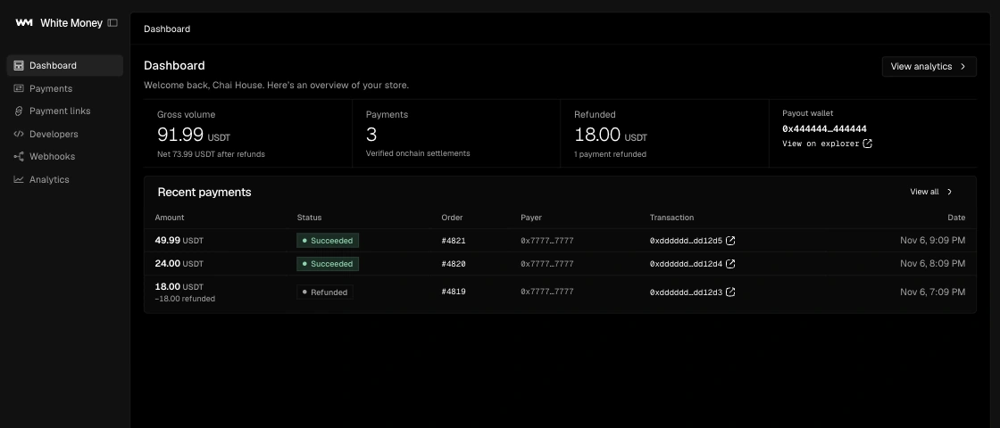

Use the [merchant dashboard](https://100lana.com/dashboard) to manage payments.

## Pages

| Route | Page |
| --- | --- |
| `/signup` | Create a merchant account |
| `/login` | Log in |
| `/dashboard` | Home: onboarding checklist, totals, recent payments, integration snippets |
| `/dashboard/payments` | Payments list |
| `/dashboard/payments/:id` | Payment detail, timeline and refunds |
| `/dashboard/payments/export` | CSV download of payments and refunds |
| `/dashboard/developers` | Secret keys and integration snippets |
| `/dashboard/webhooks` | Webhook endpoints, signing secrets and the delivery log |
| `/dashboard/agents` | MCP server URL, setup snippets for agent clients and the tool list ([Agents and MCP](./agents.md)) |
| `/dashboard/settings` | Business name, payout wallet and account details |

Every `/dashboard` route requires a logged-in merchant. If you're signed out, you're redirected to `/login`.

## Sign up and log in

Go to `/signup` and enter:

| Field | Rules |
| --- | --- |
| Business name | 2 to 80 characters. Customers see it at checkout. |
| Work email | A valid email address. One account per email. |
| Password | 8 to 200 characters. |

After signup you land on `/dashboard`. Log in later at `/login` with the same email and password.

Sessions last 7 days. The session cookie (`wc_session`) is `httpOnly`, `SameSite=Lax`, and `Secure` when the app runs in production. **Log out** in the header ends the session.

### Account status and World ID

A merchant account is either `active` or `pending`. Only active merchants can register a payout wallet, create secret keys and create checkout sessions.

The dashboard shows a **Pending verification** badge if your account is pending. An active account is required to register a payout wallet or create an API key.



*Example dashboard for Chai House with synthetic payments.*

## Onboarding checklist

Until every step is done, the home page shows a "Get set up to accept USDT" checklist with a progress bar. Only the current step shows its controls.

| Step | Done when |
| --- | --- |
| 1. Add your business | Always done after signup. Edit the name in Settings. |
| 2. Verify you're human | The account is `active`. |
| 3. Connect your payout wallet | A payout address is registered onchain. |
| 4. Create an API key | You have at least one secret key that isn't revoked. |
| 5. Add a webhook endpoint | You have at least one webhook endpoint. |

The home page also shows:

- **Gross volume**, with net volume after refunds.
- **Payments**, the number of verified onchain settlements.
- **Refunded**, the refunded total and how many payments had a refund.
- **Payout wallet**, with an explorer link, or a link to add one.
- **Recent payments**, the last five.
- Server and client code snippets that use the dashboard origin.

The home page refreshes every 5 seconds while the tab is visible. Refreshing pauses while a dialog is open, so a one-time secret key isn't lost.

## Payout wallet

Payments settle straight to your payout wallet, and refunds are signed from it. The platform never holds funds.

You can set it from the onboarding checklist or from **Settings > Payout wallet**:

1. Choose **Connect wallet** to use the address of your browser wallet (an injected wallet such as MetaMask or Rabby), or **Paste an address instead**.
2. Choose **Use as payout wallet** (or **Change payout wallet** if you already have one).

You don't sign anything. The backend signer, which owns the `PaymentRouter` contract, calls `registerMerchant(chainMerchantId, payout)` onchain and waits for the receipt. This takes a few seconds. When it's done, the dashboard links to the registration transaction on the explorer.

The address is rejected if it isn't a valid address or is the zero address. Submitting your current payout again does nothing.

### Rate limits

Every registration costs the backend signer gas, so changes are rate limited:

| Limit | Value |
| --- | --- |
| Per merchant | One change every 5 minutes |
| Across all merchants | New changes are refused while 60 or more merchants have changed their payout in the past hour |

If the onchain registration fails, your 5 minute cooldown is released and you can try again right away.

### Changing the payout wallet

Changing it calls `registerMerchant` again, which overwrites the payout onchain. After a change:

- New payments settle to the new wallet.
- Payments that already settled to the old wallet stay recorded.
- Only the current payout wallet can sign refunds, including refunds of older payments. The payment page warns you when a payment settled to a different address than your current payout.

## Secret keys

Manage keys on **Developers** (`/dashboard/developers`). Keys are for your server only. Send them as `Authorization: Bearer sk_test_...`. See the [API reference](./api-reference.md).

### Create a key

1. Choose **Create secret key**.
2. Optionally give it a name of up to 60 characters. Without a name it's called "Default".
3. Choose **Create key**, then copy the key.

The full key is shown once. Only its SHA-256 hash is stored, so it can't be shown again. Store it in your server environment, for example as `WC_SECRET_KEY`.

Keys look like `sk_test_` followed by 32 letters and digits. All keys are test keys. You need an `active` account to create one.

### The keys table

| Column | Content |
| --- | --- |
| Name | The name you gave the key |
| Key | The first 12 characters (`sk_test_` plus 4 more), then `••••••••` |
| Created | Creation date |
| Last used | When the key last authenticated an API request, or "Never" |

### Revoke a key

Choose **Revoke** on the key and confirm. Requests with that key fail right away. Revoking can't be undone. Revoked keys stay in the table with a "Revoked" badge and their revocation date.

The Developers page also shows your API base URL (ending in `/api/v1`), the `PaymentRouter` address, the USDT address, and a three-step integration guide.

## Webhooks

Manage endpoints on **Webhooks** (`/dashboard/webhooks`). For the event format and how to verify signatures, see [Webhooks](./webhooks.md).

### Add an endpoint

Enter a full `http://` or `https://` URL and choose **Add endpoint**. You can add up to 10 endpoints. Every endpoint receives both event types, `payment.succeeded` and `refund.succeeded`.

Use a public HTTPS endpoint your store controls. The hosted platform cannot deliver webhooks to localhost or private addresses.

### Signing secret

Each endpoint gets its own signing secret: `whsec_` followed by 32 letters and digits. The card shows only the last four characters (`whsec_…abcd`). Choose **Reveal** to see the full secret, then **Copy** or **Hide**.

### Endpoint actions

| Action | What it does |
| --- | --- |
| **Send test event** | Sends one synthetic `payment.succeeded` event right away. Only available while the endpoint is enabled. |
| **Disable** / **Enable** | A disabled endpoint gets no new deliveries. A delivery that was already queued fails on its next attempt with "Endpoint is disabled" and isn't retried. |
| **Delete** | After you confirm, stops all deliveries to the URL and removes its delivery log. |

The test event uses placeholder values: a payment id starting with `pay_test_`, session id `cs_test`, order id `test_order`, amount `1.00` USDT, payer `0x000000000000000000000000000000000000dEaD`, and a placeholder transaction hash (`0x000…0001`). It's signed with the endpoint's real secret. The result (HTTP status and duration) is shown on the card. Test events are never retried. If one fails, fix the endpoint and send another.

### Delivery log

**Recent deliveries** lists the last 50 deliveries across all endpoints.

| Column | Content |
| --- | --- |
| Event | Event type, a "Test" badge for test events, and the endpoint URL |
| Status | **Delivered**, **Retrying** or **Failed** |
| Attempts | Number of attempts so far |
| Last response | Last HTTP status code, or "error" if there was no response |
| Next retry | When the next attempt is due (only while retrying) |
| Created | When the delivery was created |

Expand a row to see every attempt: its number, HTTP status (or "No response"), duration, time, error, and the first 1024 bytes of the response body.

Failed deliveries are retried 1 minute, 5 minutes and 30 minutes after a failure, so there are at most 4 attempts. Then the delivery is **Failed**. For timeouts, redirects and which failures are final, see [Webhooks: respond and retry](./webhooks.md#respond-and-retry).

**Redeliver** sends the delivery again right now. It resets the attempt counter, so if this attempt fails, the full retry schedule starts over. The page refreshes every 10 seconds while any delivery is retrying.

Deliveries are at least once, so deduplicate on the event `id`.

## Payments

**Payments** (`/dashboard/payments`) lists your latest 100 payments, newest first. A payment appears only after the indexer has verified its `PaymentSettled` event onchain.

| Column | Content |
| --- | --- |
| Amount | Amount in USDT, with the refunded amount below it if any |
| Status | Succeeded, Partially refunded or Refunded |
| Order | Your `orderId` |
| Payer | The customer's wallet |
| Transaction | Explorer link to the payment transaction |
| Date | When the payment was recorded |

The list refreshes every 5 seconds. Select a row to open the payment.

### Payment detail

The payment page (`/dashboard/payments/:id`) shows the amount, status, order id and date, and the refund controls.

The **Timeline** lists, newest first:

- Checkout session created, with the session id.
- Payment succeeded, with the block number and transaction link.
- Each refund, either "requested" (pending a signature) or "Refunded", with its transaction link.
- Each webhook delivery about this payment: delivered, retrying, queued or failed, with the HTTP status, endpoint URL and attempt count.

**Details** shows the amount, refunded and refundable amounts, payment id, order id, customer wallet, the wallet the payment settled to, the transaction, the onchain payment id, the chain ID, and any `metadata` you set on the checkout session.

The page refreshes every 5 seconds while a refund is pending or a webhook delivery about the payment is queued or retrying.

## Refunds

Refunds are signed by your payout wallet in your browser. The USDT moves from the payout wallet back to the customer, so the payout wallet needs enough USDT and some WBT for gas. For the API side of refunds, see [Refunds](./refunds.md).

To refund from a payment page:

1. Choose **Refund**. The amount field starts empty, so a full refund is never sent by accident.
2. Enter an amount, or choose **Max** to fill in the full refundable amount. Partial refunds are fine.
3. Choose **Connect payout wallet**. Check that the connected account matches your payout wallet. If it doesn't, the dialog says so and you need to switch accounts in your wallet.
4. Choose **Send refund**. If your wallet is on another network, you're asked to switch networks.
5. If the router's USDT allowance is too low, approve exactly the refund amount in your wallet first.
6. Confirm the `refund(paymentId, amount)` transaction in your wallet.

The dashboard waits for each transaction, then records the refund. The dialog ends with "Refund sent" and a link to the transaction. Your webhook endpoints get a `refund.succeeded` event.

The refundable amount is the paid amount minus what was already refunded onchain and minus pending refund requests. Before sending, the dashboard checks that the payout wallet holds enough USDT.

For a refund you start in the dialog, the pending request is removed if anything fails before the refund transaction is broadcast (for example you reject a wallet prompt, the payout wallet holds too little USDT, or the approval reverts) or if the refund transaction reverts, so its amount isn't held back. A request created with the API stays pending in those cases. If the refund transaction was sent but the dashboard stopped waiting for it (after 2 minutes), the request stays pending and the indexer marks it `succeeded` once the transaction confirms.

### Pending refunds created with the API

`POST /api/v1/refunds` creates a `pending` refund, but the API can't move funds. Each unsigned pending refund appears on the payment page as two buttons:

- **Sign pending X USDT refund** opens the refund dialog with the amount fixed to the request.
- **Discard** deletes the pending request. Only `pending` refunds can be discarded. If a refund transaction for it confirms later anyway, the indexer still records the refund.

When the refundable amount is zero (everything is refunded or held by pending requests), the button reads **Fully refunded** and is disabled.

## CSV export

Choose **Export CSV** on the home page or the Payments page. The file is a ledger for your accountant with one row per payment and one row per succeeded refund. Pending refunds are left out because they moved no money.

```
GET /dashboard/payments/export
GET /dashboard/payments/export?from=2026-11-01&to=2026-11-30
```

The dashboard buttons export everything. To filter by date, add the query parameters to the URL yourself while logged in.

| Parameter | Format | Meaning |
| --- | --- | --- |
| `from` | `YYYY-MM-DD`, or an ISO date-time with a timezone such as `2026-11-01T09:00:00Z` | Include entries at or after this time. A date means 00:00 UTC. |
| `to` | Same formats | Include entries up to this time. A date includes that whole UTC day. |

An invalid date, or a `from` later than `to`, returns HTTP 400 with a plain-text message.

The file is named `whitechain-commerce-<business-name-slug>-<YYYY-MM-DD>.csv`. Rows are sorted oldest first. It's UTF-8 with a byte order mark, so Excel opens it correctly, and lines end with CRLF.

| Column | Content |
| --- | --- |
| `date` | ISO 8601 time the payment was recorded or the refund was created |
| `type` | `payment` or `refund` |
| `payment_id` | `pay_...` |
| `refund_id` | `re_...` for refunds, empty for payments |
| `order_id` | Your order id |
| `session_id` | `cs_...` |
| `amount` | Decimal USDT amount. Refunds are negative, for example `-2.00`. |
| `currency` | Always `USDT` |
| `status` | The payment's current status (`succeeded`, `partially_refunded`, `refunded`), or `succeeded` for refunds |
| `payer` | Customer wallet |
| `payout` | The payout wallet the payment settled to |
| `tx_hash` | Transaction hash |
| `explorer_url` | Explorer link to the transaction |
| `block_number` | Block number |

Text cells that start with `=`, `+`, `-`, `@`, a tab or a carriage return get a leading `'`, so spreadsheet apps show them as text instead of running them as formulas. The `amount` and `block_number` columns are numeric and aren't changed, so negative refund amounts stay numbers.

## Settings

**Settings** (`/dashboard/settings`) has three sections:

- **Business**: edit the business name (2 to 80 characters). It's shown to customers at checkout.
- **Payout wallet**: add or change the payout wallet, as described in [Payout wallet](#payout-wallet).
- **Account**: your email, status, merchant id (`mer_...`), onchain merchant id, chain ID (1874) and signup date. Both ids have a copy button.

## Related

- [Quickstart](./quickstart.md)
- [Webhooks](./webhooks.md)
- [Refunds](./refunds.md)
- [Testing](./testing.md)
- [Payment links](./payment-links.md)
